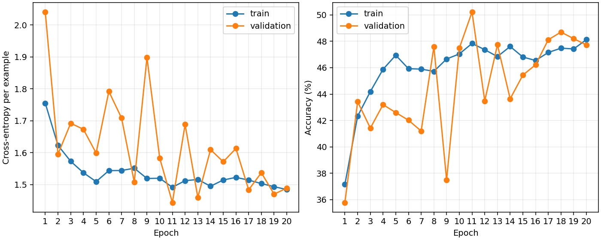

# CIFAR-10 CNN learning exercise

A small PyTorch image classifier with an end-to-end training, validation and
test workflow. Its training loop is adapted from Mamadou's existing KMNIST MLP
exercise; the original CNN architecture and optimiser settings are preserved.

## Status and provenance

The runnable learning workflow includes seeded data loading, epoch metrics,
best/final checkpoints, loss/accuracy plots and final test evaluation.
This is programming practice, not a novel architecture or a tuned benchmark.
See [PROVENANCE.md](PROVENANCE.md) for Codex-assisted implementation details.

## Method

- CIFAR-10: 10 classes, RGB images of size 32 x 32.
- Split: 45,000 training / 5,000 validation / 10,000 test images. The split
  generator uses seed 42; model initialisation and training shuffle use `--seed`.
- Transform: tensor conversion and per-channel normalisation with mean 0.5
  and standard deviation 0.5. No augmentation.
- Architecture: 3-to-32 convolution, ReLU, 2x2 max pooling; 32-to-32 convolution,
  ReLU, 2x2 max pooling; flatten 2,048 features; linear layer with 10 logits.
  Both convolutions use a 3x3 kernel and padding 1.
- Cross-entropy; SGD with learning rate 0.1, momentum 0.9 and weight decay 0.0005.
- The trainer records example-weighted loss/accuracy, including the
  shorter last batch. The former batch-mean helper is replaced by this trainer.
- Select `best.pt` by lowest validation cross-entropy (earliest exact tie).
  After training, reload it and evaluate the held-out test set once.

## Reproduce

From the **repository root**, using Python 3.10+ and compatible dependencies:

```powershell
python -m venv .venv
.\.venv\Scripts\python.exe -m pip install -r requirements.txt
.\.venv\Scripts\python.exe train.py --epochs 20 --seed 42
```

CUDA is selected when available; `--device cpu` forces CPU. CUDA needs a
compatible PyTorch build. The dataset downloads to `./data` if necessary;
`--data-root PATH --no-download` uses an existing cache without network access.
The dependency file is minimal rather than a fully locked environment.

Artifacts go to `outputs/cifar10-seed42/`: `metrics.json`, `curves.png`,
`best.pt` and `last.pt`. Use `--output-dir PATH` for another run; a nonempty
output directory is rejected to preserve existing results. Weights and data
are ignored by Git. Checkpoints include model/optimiser state, epoch and seed;
automatic resume is not implemented.

```powershell
python -B -m unittest discover -s tests -v
```

Dataset source: https://www.cs.toronto.edu/~kriz/cifar.html

## Results and limitations

The measured 20-epoch, seed-42 baseline selected epoch 11 by validation loss:

| Metric | Measured result |
|---|---:|
| Validation accuracy at selected epoch | 50.22% |
| Held-out test accuracy (10,000 images) | 50.43% |
| Held-out test cross-entropy | 1.4374 |
| Trainable parameters | 30,634 |

Full history and conditions: [metrics.json](results/metrics.json).



The earlier five-epoch workflow check is preserved in
[five_epoch_check.json](results/five_epoch_check.json): 43.45% test accuracy.
Its first five training/validation epochs match the longer run exactly.
Validation is noisy; no tuning or claim of convergence is implied.
See [VALIDATION.md](VALIDATION.md) for the exact checks and run conditions.
Only one seed is used for the initial baseline. Training accuracy is measured
while parameters change within an epoch. Deterministic settings improve repeatability
on the recorded environment; identical results across hardware/versions are not
guaranteed. No hyperparameter sweep or architectural comparison is claimed.

Earlier source attribution still needs Mamadou's review. Code is licensed under [MIT](LICENSE); see [third-party notices](THIRD_PARTY_NOTICES.md).


## Repository history

Extracted from the existing portfolio at commit
[`6ad431f`](https://github.com/mamadoufoune6-spec/Data-sciencePortfolio/commit/6ad431ff7eb69089dddb615245673d22a7ebe351).
The measured baseline is retained unchanged. This is a standalone extraction,
not a newly trained experiment. See [PROVENANCE.md](PROVENANCE.md).
